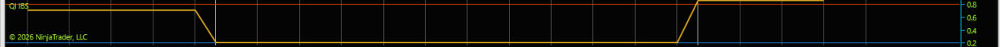
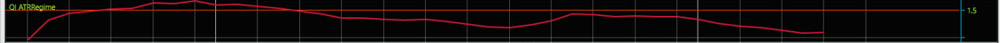
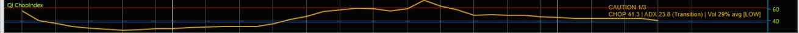

# ninjatrader_quant_indicators

Twenty-seven standalone NinjaTrader 8 indicators, one per signal module, split out of a single
3,230-line "IBSFade" multi-strategy indicator. Each file computes and displays **one** statistic
or pattern family. None of them draw buy/sell labels, arrows, profit targets, stop losses, or
ensemble "alpha counts" — those were removed on purpose.

> **Educational and informational use only. Not financial advice.** Nothing in this repository
> is a recommendation to buy or sell any instrument. Trading futures and other leveraged products
> carries a substantial risk of loss. Past performance is not indicative of future results.
> Read [DISCLAIMER.md](DISCLAIMER.md) before using any of this. Every indicator also carries the
> disclaimer in its source header and Description, and has a `Show Disclaimer` property that
> prints it on the chart (off by default to keep charts clean).

## Install

1. Copy `indicators/*.cs` into
   `Documents\NinjaTrader 8\bin\Custom\Indicators\quant_indicator\` (create the folder; any
   folder under `Indicators` works).
2. In NinjaTrader open **New › NinjaScript Editor** and press **F5** (Compile).
3. Add indicators from the chart's **Indicators** dialog — they are listed with the `QI_` prefix.

Every file is self-contained; you can copy a single indicator on its own. Tested against
NinjaTrader 8.1.8.3 (see [validation/env-pin.txt](validation/env-pin.txt)).

## Indicators

Each indicator lives in exactly one place. **Overlay** modules draw on the candle chart and never
open a sub-panel; any numeric value they compute is a hidden (transparent) plot that shows in the
DataBox — the same technique the original used. **Panel** modules are the ones whose value has
its own scale (oscillators, ratios, counts) and genuinely need a sub-panel. For those, the
thresholds the original used to classify a value are kept as **neutral reference lines**
(`Lower Threshold` / `Upper Threshold` properties) without labelling them as signals.

### Mean-reversion statistics

| Indicator | Shows | Reference lines | Panel |
|-----------|-------|-----------------|-------|
| `QI_IBS` | Internal Bar Strength of the **daily** bar, `(Close-Low)/(High-Low)` (adds a 1-day series on intraday charts) | 0.20 / 0.80 | Panel |
| `QI_RSI2` | RSI(2) | 25 / 75 | Panel |
| `QI_ConnorsRSI` | ConnorsRSI = mean of RSI(2) of price, RSI(2) of the up/down streak, 100-bar percentile rank of the 1-bar change | 15 / 85 | Panel |
| `QI_StochFade` | Fast Stochastic %K (14) and %D (3) | 30 / 70 | Panel |
| `QI_RVZScore` | Z-score of ATR(14) against its trailing 20-bar mean/std | 2.0 / -1.5 | Panel |
| `QI_CompositeVol` | 0.40·RV z-score − 0.35·price z-score + 0.25·vol-of-vol z-score | 1.5 / -1.5 | Panel |
| `QI_TurnOfMonth` | Shades the bars inside the last-4 / first-3 calendar-day window (CST); DataBox value 1/0 | – | Overlay |
| `QI_ConsecDays` | Signed count of consecutive higher (+) or lower (−) closes | 3 / -3 | Panel |
| `QI_OvernightGap` | `(Open − previous Close) / previous Close × 100` | 0.3 / -0.3 | Panel |
| `QI_BollingerPctB` | Bollinger(20, 2σ) upper/middle/lower bands on price; %B (−100…+100) in the DataBox | – | Overlay |
| `QI_TurnaroundTuesday` | Shades Monday bars (CST); DataBox value = day of week, 0 = Sunday | – | Overlay |
| `QI_RSI14` | RSI(14) | 40 / 60 | Panel |
| `QI_VRPProxy` | ATR(5) / ATR(14) | 1.5 / 0.7 | Panel |
| `QI_WideRangeBar` | Bar range / ATR(14) | 1.2 | Panel |

### Context, trend and volume

| Indicator | Shows | Reference lines | Panel |
|-----------|-------|-----------------|-------|
| `QI_HedgingPressure` | Daily/weekly/monthly HP price lines and a score panel on the chart; the 4-component composite score (−100…+100: basis deviation, slope divergence, volume/price divergence, range compression) in the DataBox | – | Overlay |
| `QI_VWAPDistance` | Session VWAP line on price (intraday charts); `(Close − VWAP) / ATR(14)` in the DataBox | – | Overlay |
| `QI_MACDHistogram` | MACD(12, 26, 9) histogram | 0 | Panel |
| `QI_EMACross` | EMA(20) and EMA(50) | – | Overlay |
| `QI_SMA200Trend` | SMA(200) | – | Overlay |
| `QI_ATRRegime` | ATR(14) / SMA(ATR(14), 50) | 1.5 | Panel |
| `QI_VolumeSpike` | Volume / SMA(Volume, 20) | 1.5 | Panel |
| `QI_VolumeDelta` | Signed per-bar volume (by close direction), its 20-bar sum and 10-bar SMA | 0 | Panel |
| `QI_ChopIndex` | Choppiness Index (14) with an ADX(14) + volume 2-of-3 "choppy" state | 61.8 / 38.2 | Panel |

### Price-structure patterns

These keep the original detection logic but label events by **pattern name and confidence**
only (e.g. `Liq Sweep End: SFP + Spring (85%)`), never as buy/sell.

| Indicator | Patterns | Panel |
|-----------|----------|-------|
| `QI_LiquiditySweep` | Basic sweep (swing / prior-day / ORB / monthly levels), Swing Failure, Equal-level trap, Consolidation trap, Wyckoff Spring/Upthrust, Turtle Soup, Volume-divergence fakeout | Overlay labels; confidence and structure (±1) in the DataBox |
| `QI_OrderFlowPlus` | Delta divergence, Absorption, Exhaustion, Stacked delta, Delta reversal (from close-direction volume delta) | Overlay labels; confidence and structure in the DataBox |
| `QI_SMC` | Order-block retest, Fair-value-gap entry, Break of structure, Change of character, Displacement | Overlay labels; confidence and structure in the DataBox |
| `QI_KeyLevels` | Previous-day RTH high/low (8:30–16:00 CST), monthly high/low, 30-min opening range (8:30–9:00 CST), Asian session (17:00–02:00 CST) | Overlay lines |

## Screenshots

One per indicator (NinjaTrader 8.1.8.3, MES 5-minute chart, default parameters), in
[screenshots/](screenshots/).

| | |
|---|---|
| **QI_IBS**  | **QI_RSI2**  |
| **QI_ConnorsRSI**  | **QI_StochFade**  |
| **QI_RVZScore**  | **QI_CompositeVol**  |
| **QI_TurnOfMonth**  | **QI_ConsecDays**  |
| **QI_OvernightGap**  | **QI_BollingerPctB**  |
| **QI_TurnaroundTuesday**  | **QI_RSI14**  |
| **QI_VRPProxy**  | **QI_WideRangeBar**  |
| **QI_HedgingPressure**  | **QI_VWAPDistance**  |
| **QI_MACDHistogram**  | **QI_EMACross**  |
| **QI_SMA200Trend**  | **QI_ATRRegime**  |
| **QI_VolumeSpike**  | **QI_VolumeDelta**  |
| **QI_ChopIndex**  | **QI_LiquiditySweep**  |
| **QI_OrderFlowPlus**  | **QI_SMC**  |
| **QI_KeyLevels**  | |

## What was removed from the original, and why

The source indicator wrapped every statistic in a trade recommendation: "IBS Buy"/"Sell" text,
Multi-Alpha ensemble labels, "Buy HP"/"Sell HP", take-profit/stop-loss lines and arrows, per-signal
position sizes and literature win-rate percentages, buy/sell counters, and CSV signal logging to a
hard-coded path. All of that is gone. The literature a module was inspired by is still named in
each file's header as a concept reference; the win-rate figures are **not** reproduced because they
are unverified third-party observations.

## Known quirks preserved on purpose

The split reproduces the original math exactly, including a few things you may want to change:

- Session windows (RTH, ORB, Asian) and calendar modules are hard-coded to **US Central time**.
- `QI_VWAPDistance` resets its VWAP when the bar's calendar day-of-year changes, not at the
  session boundary, and only computes on intraday charts.
- `QI_VolumeDelta` classifies a bar's whole volume by close-to-close direction (no bid/ask data).
- Most modules return a neutral fallback (0, 1.0 or 50) until their warm-up bar count is reached,
  and nothing is computed before bar 50 (the original's global warm-up).
- On **intraday** charts the original waited one extra session before starting (its hidden daily
  series had to register a bar). The three stateful modules — `QI_ConnorsRSI`, `QI_ConsecDays`,
  `QI_CompositeVol` — do not add a daily series just to copy that, so on intraday charts their
  values differ from the original for roughly the oldest session of loaded history, then
  converge. Daily charts match exactly.

## The one deliberate formula change

`QI_BollingerPctB` uses the Bollinger **middle** band. The original's "mid" variable actually read
the *upper* band (`Bollinger.Values[0]`), so its "%B" was 0 at the upper band and −200 at the
lower. The corrected value is the standard −100…+100 %B; it equals the original's value + 100.

## Validation

The port was checked with the evidence-gated validation protocol: an environment pin, a
pre-registered claims ledger, a documentation channel and a runtime channel (external Roslyn
compile against the installed NinjaTrader assemblies, plus a bar-by-bar diff of every module's
values against the original indicator's DataBox output). See [validation/](validation/) for the
ledger, both channels' evidence and the report.

## Lineage

Original: `ninjatrading_indicator_ibs_fade` (private). Module-to-source line map:
[docs/CONVENTIONS.md](docs/CONVENTIONS.md).
