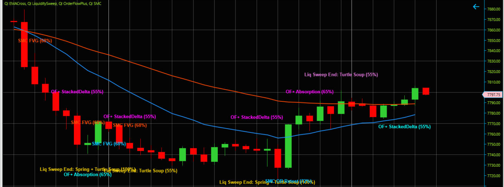

# ninjatrader_quant_indicators

Twenty-seven standalone NinjaTrader 8 indicators, one per signal module, split out of a single
3,230-line "IBSFade" multi-strategy indicator. Each file computes and displays **one** statistic
or pattern family. None of them draw buy/sell labels, arrows, profit targets, stop losses, or
ensemble "alpha counts". Those were removed on purpose. Twenty-five matching **backtest
strategies** let you test each indicator's original rule in NinjaTrader's Strategy Analyzer.
A 28th, unranked indicator, [`QI_28_IcebergDetector`](#qi_28_icebergdetector-unranked-live-and-market-replay-only),
labels probable iceberg orders at the best bid/ask on live or Market Replay data.

> **Educational and informational use only. Not financial advice.** Nothing in this repository
> is a recommendation to buy or sell any instrument. Trading futures and other leveraged products
> carries a substantial risk of loss. Past performance, including every backtest number below,
> is not indicative of future results. Read [DISCLAIMER.md](DISCLAIMER.md) before using any of
> this. Every indicator also carries the disclaimer in its source header and Description, and has
> a `Show Disclaimer` property that prints it on the chart (off by default to keep charts clean).

## What the number in each name means

`QI_NN_<Name>` is the indicator's **rank in one pre-registered historical backtest** (MES futures,
2021-01-04 → 2026-02-24, rules below). It is a label order, **not a quality grade or a forecast**:

- The top ranks are **not statistically distinguishable.** In a block bootstrap of the daily P&L,
  `QI_01` comes first among the top four in 55% of resamples, and the exact top-four order recurs
  in only 15%.
- The **Deflated Sharpe Ratio is ≈ 0 for every rule.** After accounting for 25 rules tested, none
  shows evidence of skill.
- Buy-and-hold of one MES (Sharpe 0.58) beat every rule except the top three.
- Ranks 26 and 27 have no backtestable rule. The original gave them no buy/sell class.

## Install

1. Copy `indicators/*.cs` into
   `Documents\NinjaTrader 8\bin\Custom\Indicators\quant_indicator\` (create the folder; any
   folder under `Indicators` works).
2. Optional: copy `strategies/*.cs` into `Documents\NinjaTrader 8\bin\Custom\Strategies\quant_strategies\`.
3. In NinjaTrader open **New › NinjaScript Editor** and press **F5** (Compile).
4. Add indicators from the chart's **Indicators** dialog. They are listed as `QI 01 …` to
   `QI 28 …`.

Every file is self-contained; you can copy a single indicator or strategy on its own. Tested
against NinjaTrader 8.1.8.3 (see [validation/env-pin.txt](validation/env-pin.txt)).

## Backtest results

Pre-registered protocol: [backtest/PROTOCOL.md](backtest/PROTOCOL.md); rules:
[backtest/rules.yaml](backtest/rules.yaml). Both were frozen and pushed **before** any result
existed. Every amendment is dated and disclosed in the protocol, §9.

- **Rule per indicator:** the original indicator's own Buy/Neutral/Sell classification of that
  indicator's value. No new rules, no parameter search.
- **Position:** one MES contract, long/flat/short.
- **Execution:** the signal is read at the bar close and executed at the **next bar's open**.
- **Costs:** USD 2.25 per contract per side (1-tick slippage plus USD 1.00 commission and fees).
- **Frames:** daily rules use NinjaTrader's daily bars, which close at **settlement**
  (amendment A1). Intraday rules use 15-minute bars.
- **Data:** MES continuous, 1-minute, 2020–2026, back-adjusted. 2020 is warm-up only.
- **Metric:** annualised Sharpe ratio of daily USD P&L. The table also shows the Probabilistic
  Sharpe Ratio PSR(0) of Bailey & López de Prado (2012).

| # | Indicator | Frame | Sharpe | Sharpe H1 / H2 | Sharpe at 0× / 2× costs | Net P&L USD | Max DD USD | Days in market | Position changes | Rank under 16:00 / 15:00 close | PSR(0) |
|---|---|---|---:|---:|---:|---:|---:|---:|---:|---:|---:|
| 01 | `QI_01_ConsecDays` | D | 0.88 | 1.48 / 0.46 | 0.96 / 0.81 | 9,294 | 2,279 | 25% | 346 | 4 / 3 | 0.99 |
| 02 | `QI_02_RSI14` | D | 0.66 | 0.77 / 0.59 | 0.70 / 0.62 | 9,351 | 3,972 | 49% | 249 | 1 / 1 | 0.94 |
| 03 | `QI_03_RSI2` | D | 0.63 | 1.18 / 0.19 | 0.72 / 0.54 | 10,577 | 3,910 | 62% | 628 | 2 / 2 | 0.93 |
| 04 | `QI_04_WideRangeBar` | D | 0.41 | 0.22 / 0.55 | 0.48 / 0.34 | 5,484 | 4,254 | 26% | 396 | 5 / 4 | 0.83 |
| 05 | `QI_05_ATRRegime` | D | 0.39 | 0.27 / 0.51 | 0.39 / 0.39 | 7,594 | 7,058 | 98% | 8 | 6 / 5 | 0.81 |
| 06 | `QI_06_VRPProxy` | D | 0.29 | 0.61 / 0.36 | 0.29 / 0.29 | 1,876 | 1,012 | 1% | 6 | 7 / 7 | 0.79 |
| 07 | `QI_07_SMA200Trend` | D | 0.27 | -0.01 / 0.53 | 0.28 / 0.27 | 5,716 | 8,400 | 100% | 36 | 8 / 8 | 0.73 |
| 08 | `QI_08_CompositeVol` | D | 0.27 | -0.21 / 0.54 | 0.30 / 0.23 | 2,169 | 2,305 | 14% | 115 | 9 / 9 | 0.75 |
| 09 | `QI_09_RVZScore` | D | 0.13 | 0.19 / 0.08 | 0.16 / 0.09 | 1,572 | 3,314 | 29% | 187 | 10 / 10 | 0.62 |
| 10 | `QI_10_IBS` | D | 0.12 | -0.07 / 0.32 | 0.27 / -0.03 | 1,722 | 4,477 | 49% | 817 | 3 / 6 | 0.61 |
| 11 | `QI_11_StochFade` | D | 0.05 | 0.17 / -0.05 | 0.09 / -0.00 | 758 | 7,194 | 72% | 330 | 11 / 11 | 0.54 |
| 12 | `QI_12_HedgingPressure` | D | 0.03 | -0.02 / 0.06 | 0.09 / -0.03 | 355 | 3,651 | 24% | 300 | 14 / 12 | 0.53 |
| 13 | `QI_13_ConnorsRSI` | D | 0.03 | -0.35 / 0.26 | 0.10 / -0.04 | 329 | 4,994 | 20% | 363 | 12 / 13 | 0.53 |
| 14 | `QI_14_EMACross` | D | -0.16 | -0.32 / -0.02 | -0.15 / -0.16 | -3,336 | 12,160 | 100% | 23 | 13 / 14 | 0.36 |
| 15 | `QI_15_TurnOfMonth` | D | -0.27 | 0.42 / -0.81 | -0.24 / -0.29 | -2,728 | 5,759 | 23% | 123 | 15 / 15 | 0.27 |
| 16 | `QI_16_MACDHistogram` | D | -0.34 | -0.12 / -0.53 | -0.31 / -0.36 | -7,053 | 10,144 | 100% | 124 | 16 / 16 | 0.22 |
| 17 | `QI_17_TurnaroundTuesday` | D | -0.45 | -0.33 / -0.58 | -0.30 / -0.60 | -3,637 | 3,893 | 20% | 527 | 17 / 17 | 0.15 |
| 18 | `QI_18_OvernightGap` | D | -0.94 | -1.39 / -0.88 | -0.90 / -0.98 | -9,337 | 9,454 | 8% | 181 | 18 / 18 | 0.00 |
| 19 | `QI_19_VolumeDelta` | 15m | -2.26 | -2.34 / -2.18 | 0.63 / -4.92 | -50,039 | 51,106 | 100% | 14,139 | 19 / 19 | 0.00 |
| 20 | `QI_20_VolumeSpike` | 15m | -3.12 | -3.22 / -3.02 | -0.12 / -6.11 | -41,421 | 42,094 | 100% | 17,696 | 20 / 20 | 0.00 |
| 21 | `QI_21_BollingerPctB` | 15m | -3.72 | -3.93 / -3.55 | -0.27 / -7.24 | -36,168 | 36,351 | 100% | 14,866 | 21 / 21 | 0.00 |
| 22 | `QI_22_LiquiditySweep` | 15m | -7.41 | -7.46 / -7.36 | -0.97 / -13.63 | -60,848 | 60,968 | 100% | 22,844 | 22 / 22 | 0.00 |
| 23 | `QI_23_VWAPDistance` | 15m | -9.88 | -9.69 / -10.11 | -0.38 / -18.72 | -91,014 | 91,185 | 100% | 31,013 | 23 / 23 | 0.00 |
| 24 | `QI_24_OrderFlowPlus` | 15m | -10.75 | -10.99 / -10.54 | -0.61 / -20.20 | -101,505 | 101,505 | 100% | 40,607 | 24 / 24 | 0.00 |
| 25 | `QI_25_SMC` | 15m | -10.85 | -11.05 / -10.70 | -0.16 / -20.62 | -107,282 | 107,282 | 100% | 44,682 | 25 / 25 | 0.00 |
| 26 | `QI_26_ChopIndex` | – | not backtestable | | | | | | | | |
| 27 | `QI_27_KeyLevels` | – | not backtestable | | | | | | | | |
| – | Buy & hold 1 MES (benchmark) | D | 0.58 | 0.40 / 0.75 | 0.58 / 0.58 | 12,188 | 6,056 | 100% | 1 | | 0.91 |

H1 = 2021-01-04 → 2023-07-31, H2 = 2023-08-01 → 2026-02-24. "Rank under 16:00 / 15:00 close"
gives the rank the rule gets when the daily bar closes at the 16:00 CT last trade (the
pre-registered v1) or at the 15:00 CT one-minute close. Full tables:
[results/REPORT.md](results/REPORT.md), [results/SENSITIVITY.md](results/SENSITIVITY.md),
[results/BOOTSTRAP.md](results/BOOTSTRAP.md); v1 is in [results/v1_last_trade/](results/v1_last_trade/).

How to read it:

- **The 15-minute rules lose to costs, not to direction.** Their gross Sharpe at 0× costs is
  near zero (`QI_19_VolumeDelta` +0.63), but 14,000–45,000 position changes at USD 4.50 per
  round turn bury them.
- **Long-biased daily rules ride the 2021–2026 bull market.** `QI_05_ATRRegime` is long 98% of
  days and correlates 0.93 with buy-and-hold.
- **The order of ranks 2–10 depends on how the daily bar closes.** IBS is 3rd with a 16:00 close,
  6th with a 15:00 close and 10th with NinjaTrader's settlement close. NinjaTrader's daily bars
  close at settlement, so that close is used. See amendment A1 and
  [validation/adversarial-ranking.md](validation/adversarial-ranking.md).
- **Costs:** NinjaTrader's published all-in commission and fees per side are USD 0.64–0.94 on the
  default route, under the assumed USD 1.00. Rithmic or CQG routing on the Free or Monthly plans
  costs USD 1.09–1.19, and the 2× column covers that case.
- **Data limits:**
  - The 1-minute history misses 2023-04-06 → 2023-04-14 and a day or two at five yearly-file seams.
  - CME holiday sessions are one trade date, but the fixed 17:00 CT roll splits them in two (a few
    dates per year).
  - No independent intraday dataset was available without an account.

### Robustness on independent data (SPY, Stooq)

The 18 daily rules were re-run, exactly as pre-registered (amendment A3), on Stooq's SPY daily
history: 5,444 rows, 2005–2026, prices × 10 to MES scale, same costs. The raw file is kept in a
private repository, and its SHA-256 is in [results/robustness/ROBUSTNESS.md](results/robustness/ROBUSTNESS.md).
This check never changes the ranking.

| Window | Spearman vs the MES ranking | Top 4 MES rules on SPY (Sharpe, rank of 18) | Best rules on SPY | SPY buy & hold |
|---|---:|---|---|---:|
| 2021-01-04 → 2026-02-24 (same years) | 0.63 | ConsecDays 0.50 (4), RSI14 0.30 (6), RSI2 0.51 (3), WideRangeBar 0.21 (9) | ATRRegime 0.57, SMA200Trend 0.57 | 0.82 |
| 2006-05-05 → 2026-10-16 (20 years) | 0.17 | ConsecDays 0.11 (7), RSI14 0.04 (10), RSI2 0.10 (8), WideRangeBar 0.03 (11) | ATRRegime 0.62, SMA200Trend 0.37, TurnaroundTuesday 0.32 | 0.66 |

On the same years, a different instrument from a different vendor mostly agrees with the MES
order. Over 20 years the order largely disappears: the top MES rules earn Sharpe 0.03–0.11, and
the leaders are the long-biased rules. **The `QI_NN` order describes 2021–2026. It is not a lasting
property of the indicators. Buy-and-hold beat every rule in both windows.**

ES.F, the second approved Stooq dataset, is **not available**. Stooq's ES.F history page has no CSV
download link, and the direct CSV address is refused, including from the user's own browser
(2026-10-19). The SPY run is therefore the only independent check. If a CSV becomes available,
`python -I -m qibt.cli robustness` picks it up without code changes.

Reproduce: see [backtest/README.md](backtest/README.md)
(`python -I -m qibt.cli run --dataset P1 --costs 1 --close settle --out results`). The raw
NinjaTrader data is not in the repository; its licence forbids redistribution.

## Backtest strategies (`strategies/QS_NN_<Name>.cs`)

One NinjaScript strategy per backtestable indicator. Each one is generated from its indicator by
`backtest/gen_strategies.py`, so it computes the same value, and then applies the frozen rule.
Run them in **Strategy Analyzer** on MES with the "Frame" from the table: `D` = Day bars,
`15m` = 15 Minute bars. Set commission to match your plan.

**Safety:** `Backtest Only` is on by default. While it is on, a strategy:
- submits orders only during historical processing;
- trades only on the Strategy Analyzer `Backtest` account or a Sim or Playback account;
- submits no order on the last two historical bars of any account other than `Backtest`;
- forces the start behavior to `WaitUntilFlat`.

Enabled on a live account, it therefore submits nothing. Turning `Backtest Only` off removes all
of this. Don't, unless you know exactly what you are doing.

## Indicators (in rank order)

Each indicator lives in exactly one place:
- **Overlay** modules draw on the candle chart and never open a sub-panel. Any number they compute
  is a hidden (transparent) plot that shows in the DataBox.
- **Panel** modules have a value on its own scale and need a sub-panel. The original's
  classification thresholds become **neutral reference lines** (`Lower Threshold` /
  `Upper Threshold`), not signals.

| Indicator | Shows | Reference lines | Where |
|-----------|-------|-----------------|-------|
| `QI_01_ConsecDays` | Signed count of consecutive higher (+) or lower (−) closes | 3 / -3 | Panel |
| `QI_02_RSI14` | RSI(14) | 40 / 60 | Panel |
| `QI_03_RSI2` | RSI(2) | 25 / 75 | Panel |
| `QI_04_WideRangeBar` | Bar range / ATR(14) | 1.2 | Panel |
| `QI_05_ATRRegime` | ATR(14) / SMA(ATR(14), 50) | 1.5 | Panel |
| `QI_06_VRPProxy` | ATR(5) / ATR(14) | 1.5 / 0.7 | Panel |
| `QI_07_SMA200Trend` | SMA(200) | – | Overlay |
| `QI_08_CompositeVol` | 0.40·RV z-score − 0.35·price z-score + 0.25·vol-of-vol z-score | 1.5 / -1.5 | Panel |
| `QI_09_RVZScore` | Z-score of ATR(14) against its trailing 20-bar mean/std | 2.0 / -1.5 | Panel |
| `QI_10_IBS` | Internal Bar Strength of the **daily** bar, `(Close-Low)/(High-Low)` (adds a 1-day series on intraday charts) | 0.20 / 0.80 | Panel |
| `QI_11_StochFade` | Fast Stochastic %K (14) and %D (3) | 30 / 70 | Panel |
| `QI_12_HedgingPressure` | Daily/weekly/monthly HP price lines and a score panel; the 4-component composite score (−100…+100) in the DataBox | – | Overlay |
| `QI_13_ConnorsRSI` | Mean of RSI(2) of price, RSI(2) of the up/down streak, and the 100-bar percentile rank of the 1-bar change | 15 / 85 | Panel |
| `QI_14_EMACross` | EMA(20) and EMA(50) | – | Overlay |
| `QI_15_TurnOfMonth` | Shades the bars inside the last-4 / first-3 calendar-day window (CT); DataBox value 1/0 | – | Overlay |
| `QI_16_MACDHistogram` | MACD(12, 26, 9) histogram | 0 | Panel |
| `QI_17_TurnaroundTuesday` | Shades Monday bars (CT); DataBox value = day of week, 0 = Sunday | – | Overlay |
| `QI_18_OvernightGap` | `(Open − previous Close) / previous Close × 100` | 0.3 / -0.3 | Panel |
| `QI_19_VolumeDelta` | Signed per-bar volume (by close direction), its 20-bar sum and 10-bar SMA | 0 | Panel |
| `QI_20_VolumeSpike` | Volume / SMA(Volume, 20) | 1.5 | Panel |
| `QI_21_BollingerPctB` | Bollinger(20, 2σ) upper/middle/lower bands on price; %B (−100…+100) in the DataBox | – | Overlay |
| `QI_22_LiquiditySweep` | Sweep / Swing Failure / equal-level trap / consolidation trap / Wyckoff spring-upthrust / Turtle Soup / volume-divergence labels (pattern name and confidence only) | – | Overlay |
| `QI_23_VWAPDistance` | Session VWAP line on price (intraday charts); `(Close − VWAP) / ATR(14)` in the DataBox | – | Overlay |
| `QI_24_OrderFlowPlus` | Delta divergence / absorption / exhaustion / stacked delta / delta reversal labels | – | Overlay |
| `QI_25_SMC` | Order-block retest / fair-value gap / break of structure / change of character / displacement labels | – | Overlay |
| `QI_26_ChopIndex` | Choppiness Index (14) with an ADX(14) + volume 2-of-3 "choppy" state | 61.8 / 38.2 | Panel |
| `QI_27_KeyLevels` | Previous-day RTH high/low (8:30–16:00 CT), monthly high/low, 30-min opening range, Asian session (17:00–02:00 CT) | – | Overlay |

## QI_28_IcebergDetector (unranked; live and Market Replay only)

An **iceberg** is a resting limit order that shows only part of its size; when the shown part
trades, the exchange refills it from the hidden remainder. CME Globex supports such
display-quantity orders. On a price-level feed nobody can see the hidden part. What you **can**
see is a best bid (or ask) that keeps trading at one price while its displayed size keeps coming
back. The indicator flags a level when:

- volume traded into it is at least `HiddenRatio` (2.0) times the largest size it ever showed;
- its displayed size was refilled at least `MinRefills` (2) times after trades;
- at least `MinVolume` (20) contracts traded there.

It lists every flagged level in **one table in a box at the lower right of the price panel**, newest
first:

| # | Detected | Side | Price | Hidden | Traded | Shown | Refills | Conf | Status | Ended |
|---|----------|------|-------|--------|--------|-------|---------|------|--------|-------|
| #2 | 04-26 09:41:07 | ask | 7013.00 | ~15 | 21 | 6 | 3 | 70% | held | 09:42:01 |
| #1 | 04-26 09:30:12 | bid | 7012.25 | ~23 | 35 | 12 | 3 | 64% | broken | 09:31:40 |

- **Status:** `active` while the level is still live, then `held`, `broken` or `open` (session reset).
- **Chart marks:** a short line and a `#n` tag sit at each flagged price, linking it to its table row.
- **Settings:** `Max Table Rows` (8), `Table Font Size` (11) and `Table Opacity %` (85). A footer counts rows
  that don't fit.
- **Placement:** the box stays inside the price panel. It never covers the chart's labels, the copyright text or
  the axes, the `TextFixed` notes of any indicator or of you (for example the disclaimers or QI_12's score panel),
  or another QI_28 box. When there is no room it shows fewer rows. On historical bars it shows the "live or
  Market Replay only" notice.

Four DataBox values
per bar: `IcebergBidVolume`, `IcebergAskVolume` (estimated hidden size of levels that ended in the
bar), `IcebergCount` (new flags) and `MaxConfidence`.

What it can and cannot do (validated in `validation/iceberg/`):
- **No history.** It needs best bid/ask *with displayed sizes*. NinjaTrader supplies those live
  and in **Market Replay (Playback)**, but not in historical Tick Replay, which carries bid/ask
  prices only (claim R8, rejected). On historical bars it shows a notice and computes nothing, so
  it **cannot be backtested** and has no rank. Free ways to get data: NinjaTrader's Market Replay
  downloads, or recording your own live data for replay (Tools › Options › Market data).
- **Probable, not proven.** NinjaTrader's depth is market-by-price, with no order ids (claim R7).
  A market maker that re-quotes the same price after every fill, with large volume, looks the
  same as an iceberg on this data.
- **Tested on simulated books only.** On 200 simulated sessions it found 580 of 580 planted
  icebergs and flagged 0 of 1,210 decoys. The decoys are a large single resting order, a crowd
  joining without trades, and a small market maker. The simulator is built from the same
  definitions, so these numbers show that the rules work as written, **not** how often real
  icebergs are found. A real-data check needs a Market Replay run (TESTING.md section 4).
- Its rules run in a plain C# class (`IcebergEngine`). An independently written Python reference
  (`backtest/qibt/iceberg.py`) gives identical records on 1,006 runs.

## Screenshots

NinjaTrader 8.1.8.3, MES DEC26, default parameters, in [screenshots/](screenshots/). The images
were captured before the relabel, so the chart titles show the old names.

**Overlay modules on one price chart:**
- `QI_14_EMACross`: EMA 20 blue, EMA 50 orange.
- `QI_22_LiquiditySweep`: gold/orchid "Liq Sweep" labels.
- `QI_24_OrderFlowPlus`: cyan/magenta "OF+" labels.
- `QI_25_SMC`: sky-blue/orange "SMC" labels.

None of them opens a sub-panel, and the bars carry only pattern names and confidence:



| Panel module | |
|---|---|
| **QI_05_ATRRegime**: ATR(14) / SMA50(ATR14) with the 1.5 reference line |  |
| **QI_26_ChopIndex**: Choppiness Index with 38.2 / 61.8 lines and the CHOP / ADX / volume state text |  |
| **QI_10_IBS**: daily-bar Internal Bar Strength (step shape on an intraday chart) with 0.2 / 0.8 lines |  |

Still to capture: the other 20 indicators. They are added as they are captured.

## What was removed from the original, and why

The source indicator wrapped every statistic in a trade recommendation. It drew "IBS Buy"/"Sell"
text, Multi-Alpha ensemble labels, "Buy HP"/"Sell HP", and take-profit/stop-loss lines and
arrows. It also showed per-signal position sizes and literature win-rate percentages, kept
buy/sell counters, and logged signals to CSV at a hard-coded path. All of that is gone. Each
file's header still names the literature the module came from, as a concept reference. The
win-rate figures are **not** reproduced, because nobody has verified them.

## Known quirks preserved on purpose

- Session windows (RTH, ORB, Asian) and calendar modules are hard-coded to **US Central time**.
- `QI_19_VolumeDelta` classifies a bar's whole volume by close-to-close direction (no bid/ask data).
- `QI_27_KeyLevels` tests its windows against each bar's **close** time (on 5-minute bars the
  30-minute opening range uses the bars closing 08:30–08:55; on 60-minute bars it never forms).
  The previous-day levels roll at the calendar date, not the session end. Weekend skipping uses
  the calendar day, so Monday's Asian range covers only 00:00–02:00 CT. Its eight levels are
  exposed as read-only series (e.g. `OrbHigh`) for strategies and tests.
- Most modules return a neutral fallback (0, 1.0 or 50) until their warm-up bar count is reached.
  Nothing is computed before bar 50 (the original's global warm-up).
- On **intraday** charts the original waited one extra session before it started. The stateful
  modules `QI_13_ConnorsRSI`, `QI_01_ConsecDays` and `QI_08_CompositeVol` do not, so for about the
  oldest session of history their values differ from the original's. After that they converge.
  Daily charts match exactly.

## Deliberate changes from the original

- `QI_21_BollingerPctB` uses the Bollinger **middle** band. The original's "mid" variable read the
  *upper* band, so its "%B" was 0 at the upper band and −200 at the lower.
- `QI_23_VWAPDistance` resets at the **trading session** (`Bars.IsFirstBarOfSession`), as VWAP is
  officially defined, instead of at calendar midnight.

## Algorithm provenance

The definition audit (`validation/channel-a-algo-*.md`) checked every module against primary
sources only: NinjaTrader's shipped source for the built-ins, and the original publications for
the strategy concepts.

| Status | Modules |
|--------|---------|
| Published | RSI(2), RSI(14), Stochastic, MACD histogram, EMA 20/50, SMA 200, Choppiness Index formula, Bollinger bands, overnight gap, relative volume. All built-ins (RSI, EMA, SMA, ATR, StdDev, MACD, Bollinger, Stochastics, ADX) match NinjaTrader's source. |
| Deviates (documented in the file header) | `QI_13_ConnorsRSI` (RSI(2) of price and streak carry-over, against Connors' RSI(3) and reset), `QI_15_TurnOfMonth` (calendar-day window, against a trading-day window), `QI_21_BollingerPctB` (%b rescaled), `QI_01_ConsecDays` (tie rule), `QI_12_HedgingPressure` (a price/volume composite, **not** the COT-based measure of Basu & Miffre 2013) |
| Heuristic / no authoritative definition | `QI_10_IBS` (practitioner definition), `QI_09_RVZScore`, `QI_08_CompositeVol`, `QI_06_VRPProxy`, `QI_05_ATRRegime`, `QI_19_VolumeDelta`, the `QI_26_ChopIndex` "choppy" state, `QI_22_LiquiditySweep`, `QI_24_OrderFlowPlus`, `QI_25_SMC`, `QI_27_KeyLevels` session windows |

## Validation and tests

Every claim went through **evidence-gated validation**: a frozen claims ledger, a documentation
channel (vendor, exchange and academic sources only) and an independent runtime channel. A claim
is accepted only when both channels agree. Four passes:

1. **Port fidelity:** the split modules against the original indicator. See
   `validation/claims-ledger.md`.
2. **Algorithms:** published definitions against computed values. See
   `validation/algo-claims-ledger.md`.
3. **Backtest:** CME contract specs, NinjaTrader fees and fill semantics, Sharpe/PSR/DSR (the
   papers' own worked examples are unit tests), costs, sessions and rule thresholds. See
   `validation/backtest-claims-ledger.md`, `channel-a-backtest.md` and `channel-b-backtest.md`.
   An independent re-implementation matched every metric to 1e-6.
4. **Adversarial review of the ranking:** look-ahead, data, arithmetic, fidelity and noise. See
   `validation/adversarial-ranking.md`. It found the settlement-close issue (amendment A1).

The Python ports of the four pattern modules reproduce the original indicator exactly on
2,134,141 one-minute bars, with 0 mismatches (`validation/channel-b-patterns.md`).

**Where the unit tests for each indicator are:** `tests/indicators/test_<Name>.py` — one file per
indicator (e.g. `tests/indicators/test_ConsecDays.py` for `QI_01_ConsecDays`) with hand-computed
formula cases, the C# interface contract, a single-file compile, a comparison with values exported
from NinjaTrader, and at least one falsifier. A coverage gate fails if any indicator lacks its
file. The iceberg detector's rules are tested in `backtest/tests/test_iceberg.py`. How to run everything, including the NinjaTrader export comparison: [TESTING.md](TESTING.md).

Test suites (Python 3.9; `pip install -r backtest/requirements.txt`):

```
python -I -m pytest -q -m "not slow"                # all three suites (pytest.ini)
python -I -m pytest tests/indicators -q -m "not slow"
python -I -m pytest validation/pytests -q -m "not slow"
python -I -m pytest backtest/tests -q -m "not slow"
python -I -m pytest backtest/tests -q -m slow        # P1 data needed (not in the repo)
```

They cover:
- unit tests of every indicator formula and every engine step;
- property tests: bounds, scale and shift invariance, no look-ahead, determinism, back-adjustment
  invariance, cost monotonicity;
- integration tests: end-to-end runs, run-twice determinism, P&L reconciliation;
- data-integrity tests on exported bars;
- repository invariants: no buy/sell artifacts, disclaimers present, strategy safety guard, rule
  parity between `rules.yaml` and the strategies;
- compile smoke tests against the installed NinjaTrader assemblies;
- published-example tests from the PSR/DSR papers.

Each test file includes `test_falsifier_*` tests, which show that the assertions fail on
deliberately broken code.

Online datasets that were evaluated: [docs/DATASETS.md](docs/DATASETS.md). Publishing options:
[docs/PUBLISHING.md](docs/PUBLISHING.md).

## Lineage

Original: `ninjatrading_indicator_ibs_fade` (private). Module-to-source line map (pre-relabel
names): [docs/CONVENTIONS.md](docs/CONVENTIONS.md). Rename map: [backtest/names.json](backtest/names.json).
